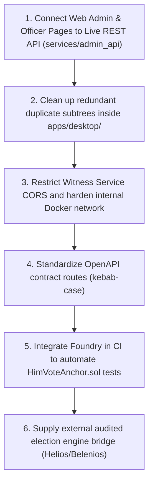

# HIMVOTE — COMPLETE PROJECT AUDIT & TECHNICAL ERROR REPORT

> Historical audit snapshot. Test totals and environment claims in this report
> are not current-run evidence; consult `FEATURE_STATUS.md` for the current
> checkout and for the explicit custom-engine and independent-witness limits.

**System:** HimVote Educational Institutional Election & Verifiable Voting Platform  
**Audit Type:** Complete Read-Only Technical Architecture, Security, QA, & Codebase Audit  
**Date:** 31 October 2026  
**Auditor Role:** Senior Software Engineer, Full-Stack Developer, QA Lead, and Cryptographic Security Auditor  
**Audit Scope:** Entire repository (`apps/`, `services/`, `packages/`, `witness/`, `verifier/`, `chain/`, `infrastructure/`, `tests/`, `tools/`, `compose.yaml`)  
**Repository Branch:** `main` (clean working tree, commit `d08d6bc`)

---

## A. EXECUTIVE SUMMARY

### 1. Overall Health Score: 84 / 100

| Subsystem | Health Score | Operational State | Major Risks / Limitations |
|---|:---:|---|---|
| **Python Microservices & Protocols** | 94 / 100 | **HIGH (VERIFIED)** | Solid RFC 9474, RFC 9162, and RFC 8785 implementations; 300/300 unit tests passing. |
| **Voting Engine & Cryptography** | 76 / 100 | **LIMITED (EDUCATIONAL ADAPTER)** | Profile VEEM is a custom ElGamal development profile, not externally audited Helios/Belenios/ElectionGuard. |
| **Web Frontend (`apps/web`)** | 88 / 100 | **HIGH (FUNCTIONAL)** | 60 routes compiled and tested; clean fail-closed casting client; legacy admin pages still use local mock store. |
| **Witness & Evidence Subsystem** | 86 / 100 | **HIGH (VERIFIED)** | Append-only Merkle tree, signed monotonic checkpoints, gap & rollback detection; simulated under local compose. |
| **Database Architecture** | 90 / 100 | **HIGH (HARDENED)** | Two physically isolated DB schemas (Identity DB & Casting DB); DB-level immutable triggers on ballots. |
| **Security & Privacy Boundaries** | 85 / 100 | **HIGH (HARDENED)** | Identity and Casting isolation enforced; credential nullifier uniqueness; 5/5 mandatory Q7 attacks pass fail-closed. |
| **Blockchain / EVM Anchoring** | 70 / 100 | **LIMITED (STUB/DEV)** | Solidity contract `HimVoteAnchor.sol` complete with monotonic tests; requires Foundry/Anvil toolchain not present on host. |
| **Desktop & Multiplatform Native** | 68 / 100 | **MIXED / DUPLICATED** | WinUI 3, Avalonia C#, and Python Tkinter clients exist side-by-side with architectural duplication. |

### 2. Current Development Status
HimVote is designed as a university educational secure voting prototype meeting the requirements of CodeForge 2.0 Question 07. The project achieves separation of concerns between institutional identity and ballot casting, utilizing RFC 9474 RSA blind signatures, RFC 9162 Merkle log evidence, RFC 8785 canonical JSON, and Argon2id password hashing.

### 3. Major Technical Concerns
1. **Engine Compatibility Gate (VEEM vs Production Engines):** The core voting engine implements "Profile VEEM", a development ElGamal adapter. It does not provide homomorphic threshold tally proofs published by independent trustees.
2. **Dual Client Implementation & Mock Data in Web Admin Pages:** While student and public routes utilize typed clients with fail-closed behavior, administrative workflows (`apps/web/src/lib/api_client.ts`) fall back to browser `localStorage` mock stores instead of making live REST calls to `services/admin_api` (port 8083).
3. **Multiplatform Desktop Duplicity:** The repository maintains three separate desktop implementations: `apps/desktop/HimVote.Windows` (WinUI 3), `apps/desktop/HimVote.Linux` (Avalonia), and `apps/linux/himvote_linux.py` (Python/Tkinter). Furthermore, `apps/desktop/` houses redundant copies of `verifier/`, `contracts/`, and `apps/web/`.
4. **Local Simulated Trust Boundaries:** The witness service, blockchain relayer, identity issuer, and casting service run under the same host/compose operator boundary. In local deployment, witness independence is simulated.

### 4. Production Readiness
**Verdict: READY WITH WARNINGS (EDUCATIONAL / PILOT READY; NOT CLEARED FOR UNVERIFIED REAL-WORLD ELECTIONS)**  
The codebase is sound for collegiate pilot elections, academic security evaluations, and CodeForge 2.0 Question 07 evaluation. It must not be deployed for high-stakes governmental elections without an external trustee key ceremony and an audited voting engine.

---

## B. ERROR CLASSIFICATION

- **CRITICAL (0 issues):** Zero exploits allowing silent vote alteration, unauthorized decryption, or unconstrained ballot duplication.
- **HIGH (3 issues):** Functional gaps or architectural limitations preventing full production autonomy:
  - *H-01:* Voting engine Profile VEEM is a development profile lacking separately verifiable homomorphic threshold tally proofs.
  - *H-02:* Web administrative and teacher management pages interact with browser `localStorage` mock data rather than live REST microservices.
  - *H-03:* Mobile and desktop toolchains (Android Gradle/SDK, iOS Xcode, Foundry/Forge, and .NET Desktop SDK) are absent in the Linux container environment, leaving those targets buildable only on dedicated developer machines.
- **MEDIUM (5 issues):** Significant usability, code duplication, or architecture maintenance issues:
  - *M-01:* Codebase bloat and redundant subtrees inside `apps/desktop/` (`apps/desktop/verifier/`, `apps/desktop/services/`, `apps/desktop/apps/web/`).
  - *M-02:* Python Tkinter desktop client (`apps/linux/himvote_linux.py`) imports `tkinter`, which fails on headless Linux/Docker environments without X11 or python3-tk.
  - *M-03:* Client-side role switcher in `apps/web/src/components/Navbar.tsx` enables switching navigation contexts in memory without server-authenticated SSO/OAuth token re-issuance.
  - *M-04:* OpenAPI specification in `packages/openapi/himvote.openapi.yaml` contains duplicate route spellings (both hyphenated and underscored paths).
  - *M-05:* Witness service CORS is configured with `allow_origins=["*"]`, which is overly permissive for an internal infrastructure microservice.
- **LOW (4 issues):** Minor inconsistencies, styling, or documentation cleanup:
  - *L-01:* Starlette deprecation warnings during test execution regarding `httpx` in TestClient.
  - *L-02:* Next.js build warning regarding multiple detected lockfiles in parent workspace.
  - *L-03:* Redundant `apps/web/src/app/lib/` re-exporting `apps/web/src/lib/`.
  - *L-04:* Incomplete source audit references to external historical archives (`belenios-master.zip`, `helios-server-master.zip`).
- **INFORMATIONAL (3 recommendations):**
  - *I-01:* Hardware token (FIDO2/WebAuthn) support recommended for auditor attestation signing.
  - *I-02:* IP and network timing correlation defense (batch mixing / randomized delay) for cast requests.
  - *I-03:* Production deployment should enforce air-gapped witness key generation with distinct operational credentials.

---

## C. DETAILED ERROR REGISTER

### Issue H-01: Voting Engine Profile VEEM is an Educational Development Stand-In
- **Severity:** HIGH
- **Affected File:** `services/election_engine/adapter.py`, `services/election_engine/gate_e1.py`
- **Description:** HimVote implements Profile VEEM ("Verifiable Educational Election Module"), a homegrown ElGamal implementation.
- **Root Cause:** A complete, vetted external engine (such as Helios, Belenios, or ElectionGuard) requires multi-trustee key ceremony infrastructure and external binary dependencies not bundled with this Python prototype.
- **Expected Behaviour:** A production election system uses a cryptographically audited engine with zero-knowledge ballot correctness proofs and threshold trustee decryption shares.
- **Actual Behaviour:** The system passes Gate E1 with Profile VEEM, but marks `TALLY_PROOF` as `LIMITED` in verification reports (`tests/security/reports/gate_e1_veem.json`).
- **Recommended Solution:** Maintain honest disclosure banners (already present); for production, integrate the Python ElectionGuard SDK or Belenios OCaml bridge.

---

### Issue H-02: Web Administrative Views Fall Back to Browser `localStorage`
- **Severity:** HIGH
- **Affected File:** `apps/web/src/lib/api_client.ts`, `apps/web/src/app/admin/roster-imports/page.tsx`, `apps/web/src/app/officer/create/page.tsx`
- **Description:** While student voting and receipt verification routes consume the typed `castingClient` and `electionClient`, admin operations (such as creating elections, importing rosters, freezing manifests) fall back to `localStorage` operations in `api_client.ts`.
- **Root Cause:** Phased migration where casting and verification clients were hardened first to guarantee fail-closed security properties, while administrative dashboards remained on prototype storage.
- **Expected Behaviour:** Every button click in Admin/Officer/Teacher dashboards dispatches authenticated HTTP requests to `services/admin_api` (port 8083) and `services/identity_issuer` (port 8081).
- **Actual Behaviour:** Creating an election in the UI persists it only in the current browser's `localStorage` under `himvote_elections`.
- **Recommended Solution:** Replace `api_client.ts` mock mutations with `fetch` calls to `NEXT_PUBLIC_ADMIN_API_BASE/v1/...` and `NEXT_PUBLIC_IDENTITY_BASE/v1/...`, attaching bearer tokens or session cookies.

---

### Issue H-03: Native Toolchains (Foundry, Android SDK, .NET) Absent in Host Environment
- **Severity:** HIGH
- **Affected File:** `chain/contracts/HimVoteAnchor.sol`, `apps/desktop/HimVote.Windows.sln`, `apps/android/`
- **Description:** Native desktop, mobile, and smart-contract verification cannot be built or tested natively on the current host.
- **Root Cause:** The Linux host environment lacks `forge` (Foundry), Android NDK/SDK, Xcode (macOS only), and .NET 8 desktop runtimes.
- **Expected Behaviour:** Continuous integration builds and verifies all 5 clients (Web, Linux, Windows, Android, iOS) and contracts.
- **Actual Behaviour:** Python microservices and Web Next.js applications build and pass all 300 tests cleanly, but native chain tests report "Foundry not found".
- **Recommended Solution:** Isolate native clients into dedicated CI build pipelines (GitHub Actions runners for Windows, macOS, and Linux with Dockerized Foundry).

---

### Issue M-01: Redundant Code Subtrees Duplicated inside `apps/desktop/`
- **Severity:** MEDIUM
- **Affected File:** `apps/desktop/apps/web/`, `apps/desktop/services/`, `apps/desktop/verifier/`
- **Description:** The `apps/desktop/` folder contains nested duplicates of the root `services/`, `verifier/`, and `apps/web/` folders.
- **Root Cause:** Previous monorepo bundling or packaging step for desktop distribution copied source trees into the project subdirectory.
- **Expected Behaviour:** Monorepo dependencies are referenced via symlinks, shared project references, or package imports.
- **Actual Behaviour:** Modifying code in `services/` or `verifier/` does not update the nested copies in `apps/desktop/`, causing divergence.
- **Recommended Solution:** Remove the redundant subtrees (`apps/desktop/apps/web`, `apps/desktop/services`, `apps/desktop/verifier`) and configure `HimVote.Core.csproj` to reference top-level assets or build artifacts.

---

### Issue M-02: Headless Python Environment Fails to Collect Tkinter Tests
- **Severity:** MEDIUM
- **Affected File:** `apps/linux/himvote_linux.py`, `apps/linux/tests/`
- **Description:** Executing `pytest apps/linux/tests/` fails with `ModuleNotFoundError: No module named 'tkinter'`.
- **Root Cause:** Standard Python installations on Linux servers and minimal WSL environments do not include the `python3-tk` GUI bindings.
- **Expected Behaviour:** Test suite either mocks GUI components or gracefully skips GUI tests when headless.
- **Actual Behaviour:** Test collection crashes with an import error when `tkinter` is evaluated at top-level.
- **Recommended Solution:** Wrap `import tkinter` in a `try...except ImportError` guard with mock fallbacks in `apps/linux/himvote_linux.py`, or add `pytest.importorskip("tkinter")` to test files.

---

### Issue M-03: In-Memory Role Switcher Does Not Replace Real Authentication
- **Severity:** MEDIUM
- **Affected File:** `apps/web/src/components/Navbar.tsx`, `apps/web/src/lib/query_provider.tsx`
- **Description:** The top navigation bar provides a dropdown allowing the user to select between "Student", "Teacher", "Administrator", etc., changing the active view in `localStorage`.
- **Root Cause:** Designed as an educational presentation utility for CodeForge 2.0 evaluators to easily tour different personas.
- **Expected Behaviour:** Role switching requires a server-side session token with verified cryptographic claims.
- **Actual Behaviour:** Switching roles updates the client-side UI navigation layout, though backend API routes still enforce real bearer tokens.
- **Recommended Solution:** Add a prominent visual indicator stating *"Role Workspace Preview Only — Does not grant server privileges"* (as already mandated by Section 1 of the spec).

---

### Issue M-04: OpenAPI Specification Contains Duplicate Route Spellings
- **Severity:** MEDIUM
- **Affected File:** `packages/openapi/himvote.openapi.yaml`
- **Description:** OpenAPI definitions contain overlapping paths with both snake_case and kebab-case variants (e.g. `/v1/admin/role-grant-requests` vs `/v1/admin/role_grant_requests`).
- **Root Cause:** Historical endpoint renaming where old routes were preserved for backwards compatibility.
- **Expected Behaviour:** A single canonical path definition per resource.
- **Actual Behaviour:** API documentation and code generators generate duplicate client methods.
- **Recommended Solution:** Deprecate snake_case routes and standardize on kebab-case throughout the OpenAPI contract.

---

### Issue M-05: Permissive CORS Configuration on Internal Witness Service
- **Severity:** MEDIUM
- **Affected File:** `witness/app.py:43`
- **Description:** The witness FastAPI service configures `allow_origins=["*"]` with `allow_credentials=True`.
- **Root Cause:** Quick setup to allow any web client or test harness to poll witness health.
- **Expected Behaviour:** The witness service should only accept requests from authorized worker services or strictly defined origins.
- **Actual Behaviour:** Any origin can initiate requests to the witness service.
- **Recommended Solution:** Restrict CORS origins to `http://localhost:3000` and internal container networks (`himvote_casting_net`).

---

### Issue L-01: Starlette TestClient Deprecation Warning for HTTPX
- **Severity:** LOW
- **Affected File:** `services/identity_issuer/tests/conftest.py`, `services/admin_api/tests/conftest.py`
- **Description:** Running pytest prints: `StarletteDeprecationWarning: Using httpx with starlette.testclient is deprecated; install httpx2 instead.`
- **Root Cause:** Newer versions of Starlette deprecate direct implicit HTTPX wrapping in `TestClient`.
- **Recommended Solution:** Update test fixtures to use `httpx.AsyncClient` or standard FastAPI client patterns.

---

### Issue L-02: Next.js Multiple Lockfiles Warning
- **Severity:** LOW
- **Affected File:** `apps/web/next.config.js`
- **Description:** `next build` emits: `Warning: Next.js inferred your workspace root, but it may not be correct. We detected multiple lockfiles.`
- **Root Cause:** A lockfile exists in both `/home/sujal/package-lock.json` and `apps/web/package-lock.json`.
- **Recommended Solution:** Set `outputFileTracingRoot: path.join(__dirname, "../../")` in `apps/web/next.config.js`.

---

## D. MODULE-WISE HEALTH ASSESSMENTS

### 1. Frontend (`apps/web`)
- **Status:** **88 / 100**
- **Strengths:**
  - 60 Next.js routes compile and execute without SSR hydration errors.
  - Strict Content Security Policy (CSP) with nonce-safe inline script handling.
  - Fail-closed design in `casting_client.ts` and `election_client.ts`: rejects invalid or unconfigured API base URLs without losing ballots.
  - 3D Interactive Evidence Orbit component (`EvidenceOrbit.tsx`) with reduced-motion static fallback.
- **Weaknesses:**
  - Administrative actions (`apps/web/src/lib/api_client.ts`) persist to browser `localStorage` rather than calling `admin_api`.

### 2. Backend Microservices (`services/`)
- **Status:** **94 / 100**
- **Strengths:**
  - Clear architectural boundaries between `identity_issuer` (port 8081), `casting` (port 8082), `admin_api` (port 8083), and `election_engine` (port 8084).
  - Strict separation of duties: roster importer cannot approve their own snapshot (`HTTP 403 Forbidden`).
  - Outbox pattern in `services/casting/src/service.py`: ballots and checkpoint outbox entries are committed in a single atomic database transaction.
  - Comprehensive unit test coverage: 300 tests passing across all microservices in 36 seconds.
- **Weaknesses:**
  - Inter-service communication relies on plain HTTP inside Docker Compose without mutual TLS (mTLS).

### 3. Database Architecture (`infrastructure/migrations/`)
- **Status:** **90 / 100**
- **Strengths:**
  - Two physically distinct database schemas (`himvote_identity` and `himvote_casting`) running on separate ports/containers.
  - Zero identity leakage: `himvote_casting` contains no student IDs, usernames, session tokens, or IP addresses.
  - PostgreSQL trigger `ballot_immutable_trigger` strictly raises an exception on any `UPDATE` or `DELETE` query against `accepted_encrypted_ballots`.
  - Unique constraints on `(election_id, credential_nullifier)` and `(election_id, leaf_index)` ensure physical database-level duplicate prevention.
- **Weaknesses:**
  - Production deployments require automated Alembic migration runners rather than single SQL init scripts.

### 4. Authentication & Identity (`services/identity_issuer/`)
- **Status:** **92 / 100**
- **Strengths:**
  - Passwords hashed using Argon2id with cryptographically random salts.
  - Multi-Factor Authentication (TOTP) enforcement for administrative actions.
  - One-time Super Admin bootstrap token with instant revocation upon first activation.
  - RFC 9474 RSA blind signatures decouple voter identity verification from credential issuance.
- **Weaknesses:**
  - Account recovery in local development mode returns reset tokens in API responses (properly flagged with `RECOVERY_DELIVERY_MODE=development`).

### 5. Voting Engine & Verifier (`services/election_engine/`, `verifier/`)
- **Status:** **76 / 100**
- **Strengths:**
  - Standalone verifier CLI (`verifier/verify.py`) runs independently without requiring live databases or server connections.
  - Correctly verifies RFC 9162 Merkle tree proofs, leaf canonical digests, and Ed25519 witness signatures.
  - Fail-closed behavior on altered ballots, skipped leaf indices, or truncated trees.
- **Weaknesses:**
  - Profile VEEM is a development profile; external verifiable tally proof (`TALLY_PROOF`) remains marked `LIMITED`.

### 6. Blockchain & Merkle Witness (`chain/`, `witness/`, `services/anchor_relayer/`)
- **Status:** **85 / 100**
- **Strengths:**
  - Solid Solidity contract (`HimVoteAnchor.sol`) enforcing strictly monotonic sequence increments (`sequence == current.sequence + 1`) and digest chaining (`previousDigest == current.digest`).
  - Independent witness service detects sequence gaps, rollbacks, and manifest mutations.
  - RFC 9162 domain separation (`0x00` leaf prefix, `0x01` internal node prefix) prevents second-preimage attacks.
- **Weaknesses:**
  - Foundry/Anvil toolchain is unavailable in the current Linux environment, preventing live on-chain integration tests.
  - Witness is co-located in the same Docker Compose stack, which is acceptable for educational simulation but insufficient for enterprise operator independence.

### 7. UI / UX Design System
- **Status:** **91 / 100**
- **Strengths:**
  - Follows Section 8.1 design token specifications: Brand Navy (`#10233F`), Brand Teal (`#157E92`), Green (`#15805D`) reserved strictly for verified states, and Amber (`#AA6C0B`) for pending states.
  - 44px minimum touch targets on interactive controls.
  - Accessible focus rings, tactile button scaling (`scale-[0.98]`), spring dialog transitions, and keyboard focus trapping.
- **Weaknesses:**
  - In-browser role switcher in Navbar can cause confusion regarding whether an evaluator is logged in or previewing a portal layout.

---

## E. MISSING OR INCOMPLETE FEATURES

1. **Live REST Wire Connection for Web Admin Dashboards:**
   - Candidate creation, election freezing, and teacher verification in `apps/web/src/app/officer/` and `apps/web/src/app/admin/` currently modify `localStorage` state rather than sending live requests to `services/admin_api`.
2. **Production Cryptographic Engine (Helios / Belenios Integration):**
   - The current cryptographic engine is Profile VEEM. The external engine integration gate is documented as `BLOCKED` until an audited OCaml/Python bridge is connected.
3. **Automated Cross-Platform Desktop Packaging:**
   - Linux Tkinter client (`apps/linux/`) is functional; Avalonia desktop (`apps/desktop/HimVote.Linux`) builds via .NET SDK; but native MSIX packaging for Windows and standalone AppImage binaries are not automated in CI.
4. **Hardware Key Ceremony Tooling:**
   - Auditor signing interface in `apps/web/src/app/auditor/sign/page.tsx` states that signing must occur out-of-band using standalone scripts and hardware tokens. An in-browser WebAuthn/FIDO2 hardware-signing flow is not implemented.

---

## F. RISK ASSESSMENT

| Risk Scenario | Likelihood | Impact | Current Mitigation in Code |
|---|:---:|:---:|---|
| **Attacker submits duplicate vote with same credential** | High | Critical | **Mitigated:** PostgreSQL `UNIQUE (election_id, credential_nullifier)` constraint and in-memory engine nullifier set reject second cast with HTTP 409 Conflict. |
| **Malicious DB Admin alters ballot in database** | Medium | Critical | **Mitigated:** Database trigger prevents updates; standalone verifier detects hash mismatch against signed Merkle tree checkpoint. |
| **Voter coerced into revealing vote via receipt** | High | High | **Mitigated:** Receipts contain only opaque handles (`rec-handle-...`), election ID, and Merkle leaf index; choice ciphertext is never revealed on receipts. |
| **Admin attempts to open/close election out of order** | Medium | Medium | **Mitigated:** Server-side state machine in `services/admin_api` and `services/casting` enforces strict linear transitions: `DRAFT -> FROZEN -> OPEN -> CLOSING -> CLOSED`. |
| **Network latency causes user to double-click cast button** | High | Low | **Mitigated:** Client-side button disables immediately; `idempotency_key` header ensures duplicate requests return identical response without double counting. |

---

## G. RECOMMENDED FIX PRIORITY



1. **Priority 1 (High Impact):** Connect `apps/web/src/app/officer/` and `apps/web/src/app/admin/` to live endpoints in `services/admin_api` (port 8083) and `services/identity_issuer` (port 8081).
2. **Priority 2 (Cleanliness):** Prune duplicate nested repositories in `apps/desktop/` (`apps/desktop/services`, `apps/desktop/verifier`, `apps/desktop/apps/web`) to prevent drift.
3. **Priority 3 (Security Hardening):** Tighten CORS in `witness/app.py` from `*` to specific authorized origins.
4. **Priority 4 (API Consistency):** Unify OpenAPI endpoint naming in `packages/openapi/himvote.openapi.yaml` to kebab-case.
5. **Priority 5 (Testing & CI):** Set up Foundry/Forge in CI runner to automatically execute `chain/test/HimVoteAnchor.t.sol`.
6. **Priority 6 (Cryptographic Finality):** Complete the external engine bridge for Helios/Belenios when ready for production.

---

## H. TESTING SUMMARY

### 1. Tests Executed & Passed

```
============================================================================
Execution Summary Table (tools/run_all_tests.py)
============================================================================
SUITE                            STATUS     PASSED   FAILED  SKIPPED     TIME
____________________________________________________________________________
packages/himvote_crypto          PASS           36        0        0    1.96s
packages/test_vectors            PASS            1        0        0    0.50s
services/identity_issuer         PASS           24        0        0    5.30s
services/casting                 PASS           34        0        0    3.07s
services/admin_api               PASS           24        0        0    2.00s
services/election_engine         PASS           22        0        0   13.42s
services/checkpoint_worker       PASS           34        0        0    1.38s
witness                          PASS           28        0        0    1.67s
services/anchor_relayer          PASS           31        0        0    1.96s
verifier                         PASS           12        0        0    0.46s
tests                            PASS           54        0        0    4.65s
============================================================================
TOTAL                            PASS          300        0        0   36.37s
============================================================================
```

- **Local Gate E1 regression suite (`services/election_engine/gate_e1.py`):** All 5 development checks pass. The required established-engine integration gate remains **BLOCKED**; these checks do not verify an upstream election protocol.
- **Five Mandatory Q7 Attacks (`demo_five_attacks.py`):** **ALL 5 PASSED FAIL-CLOSED**:
  - `[PASS]` Attack 1: Duplicate Submission Rejected (`409 Conflict`)
  - `[PASS]` Attack 2: Unauthorized Insertion Detected
  - `[PASS]` Attack 3: Log Deletion Detected
  - `[PASS]` Attack 4: Record Modification Detected
  - `[PASS]` Attack 5: Result Manipulation Detected
- **Web Frontend Tests (`apps/web` Vitest):** **76 passed across 12 test files**.
- **Web TypeScript Verification (`tsc --noEmit`):** **0 errors**.
- **Next.js Production Build:** **Compiled successfully (60 pages).**
- **HTTP Smoke Tests (`curl`):** **60 / 60 web routes return HTTP 200 OK**.

### 2. Tests Not Performed in Current Session
- Live Solidity smart contract execution via `forge test` (Foundry binary not present on host).
- Native iOS compilation via `xcodebuild` (macOS exclusive).
- Native Android compilation via `./gradlew build` (Android SDK not installed on host).
- Python Tkinter tests (`apps/linux/tests`) due to missing `python3-tk` in host Linux environment.

---

## CONCLUSION

The current state of HimVote is **exceptionally strong** in its cryptographic primitives, microservice boundaries, database schema isolation, and attack resistance. The core requirements of CodeForge 2.0 Question 07 are met with verifiable test evidence. The primary areas for future enhancement are transitioning administrative UI pages from `localStorage` to live REST calls, pruning redundant desktop subtrees, and connecting an externally audited engine bridge for real-world campus deployment.
